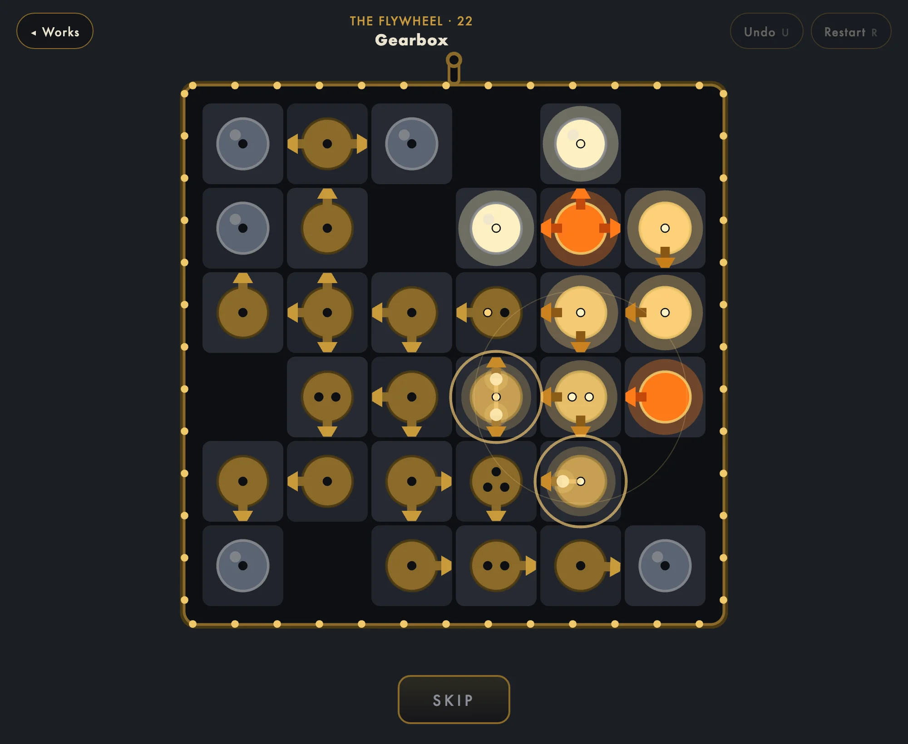
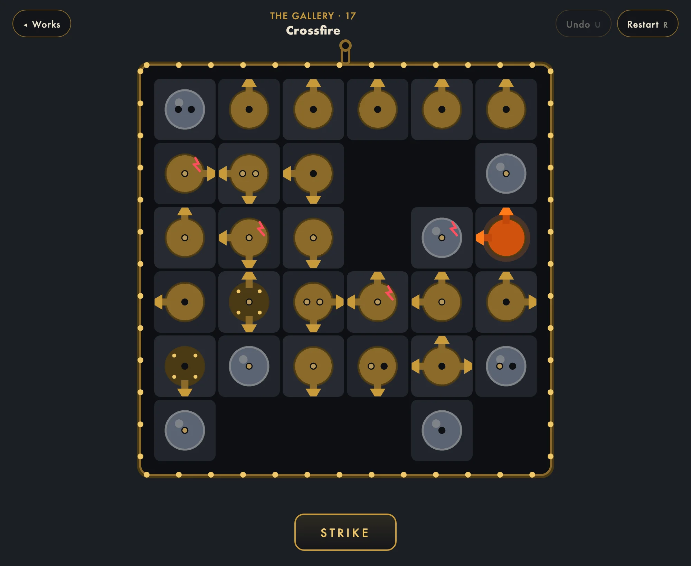
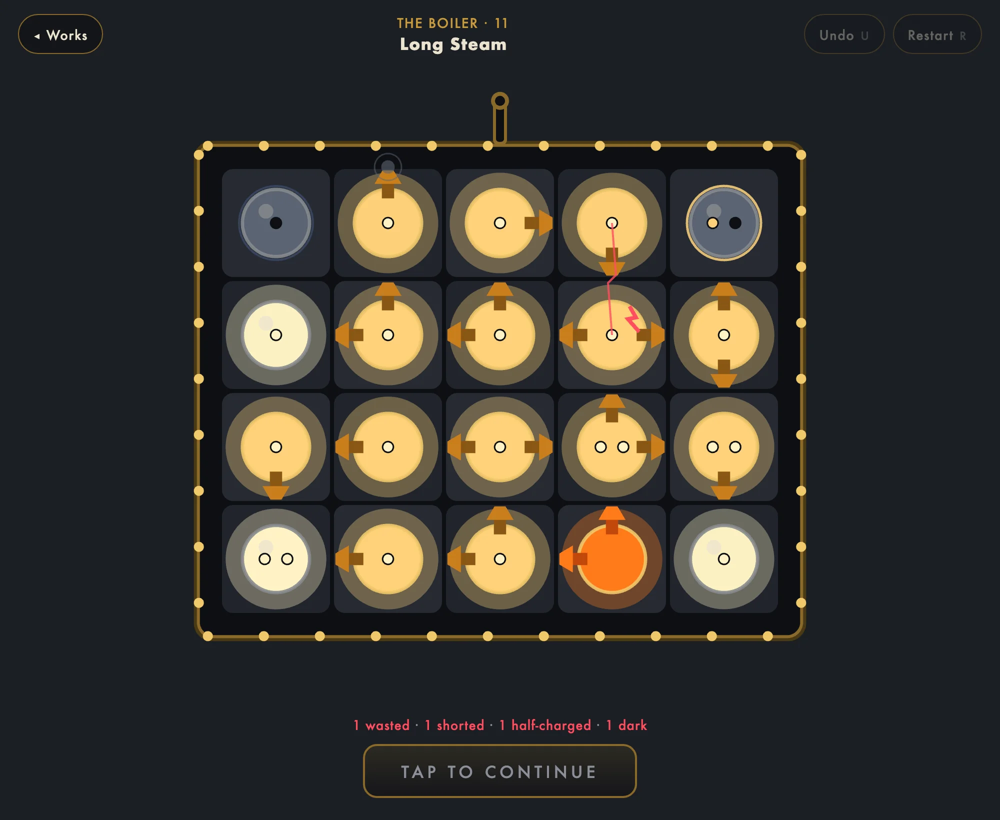
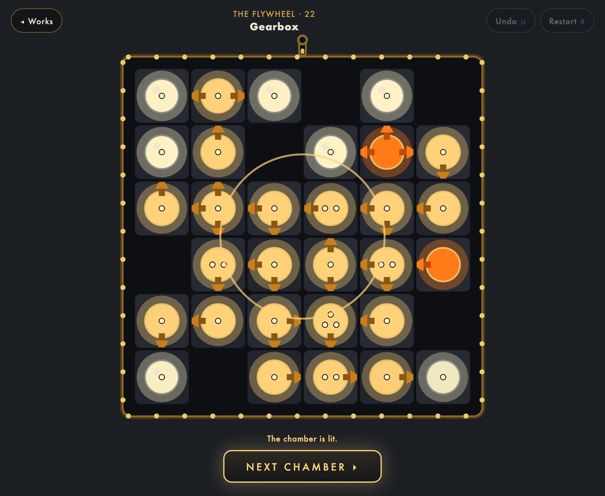
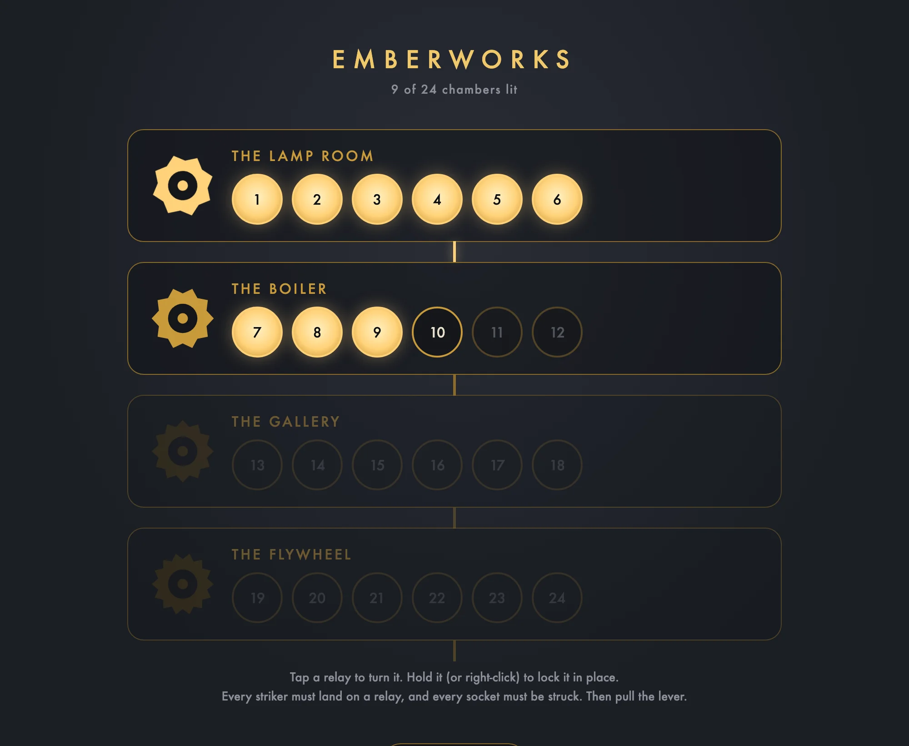
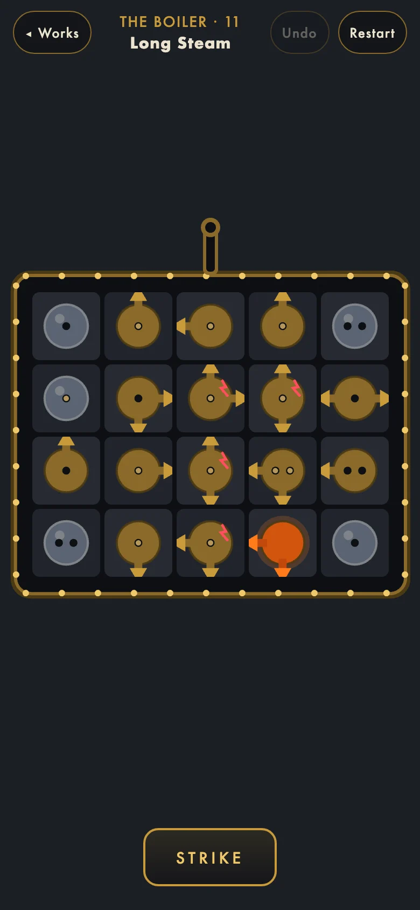

# Emberworks

**A wordless deduction puzzle about waking a dormant machine.** Every chamber
is a grid of brass relays. Turn them until every striker lands on a relay and
every socket is struck, then pull the lever. The ember fires, sparks race
down the arms, and if you reasoned right the whole chamber lights up in one
cascade.

**[Play it in your browser at emberworks.typeonce.dev](https://emberworks.typeonce.dev)**



Emberworks is calm like Sudoku and pays off like a Candy Crush cascade. There
are no timers, no lives, no move limits, and no luck: every chamber has
exactly one answer, and you can reason your way to it. The lever is free to
pull as often as you like. Nothing is lost when it goes wrong.

## The one rule

Each relay has striker arms and a number of sockets. The machine lights when

1. **nothing is wasted:** every arm points at a relay, never at the frame or
   a hole,
2. **every socket is struck:** a relay takes exactly as many arms as it has
   sockets, and a spark into a relay that already fired shorts it,
3. **sparks only flow forward:** a relay fires once all its sockets are
   filled, so it can never help light the relay that feeds it.

Counting arms and sockets gets you most of the way, like rows and boxes in
Sudoku. The third rule is the one counting cannot see: a ring of relays that
counts perfectly and still stays dark, or a two-socket relay waiting for a
spark it would have to send itself.

<table>
  <tr>
    <td></td>
    <td></td>
  </tr>
  <tr>
    <td align="center"><sub>before the first turn: lamps, bolted givens, and the ember</sub></td>
    <td align="center"><sub>a wrong pull, held: one wasted, one shorted, one half-charged, one dark</sub></td>
  </tr>
</table>

## Pull the lever, watch it work

A strike plays out wave by wave, each relay ringing a bell a step higher on
the scale. A failed strike runs to its end and holds, so you can see every
fault at once: wasted sparks fizzle at the frame, shorts flash red,
half-charged relays glow cold. Tap to continue, and the relays at fault keep
a scorch mark until you turn them.

When the chamber is lit, the spark runs up the conduit and out into the
works.



## The works

Twenty-four chambers in four rooms: the Lamp Room, the Boiler, the Gallery,
and the Flywheel. Each room wakes its part of the machine. The first chambers
teach the rule without a word of text; the last ones need two embers to meet
and a ring that counts right to stay dark.

<p align="center"></p>

It plays on a phone too: tap to turn, hold to lock a relay in place.

<p align="center"></p>

## Play

**[emberworks.typeonce.dev](https://emberworks.typeonce.dev)**. Progress
stays in your browser. To run it locally:

```sh
pnpm install
pnpm dev
```

| | |
| --- | --- |
| Tap a relay | turn it a quarter clockwise |
| Hold a relay (or right-click) | lock it in place, as a pencil mark |
| Space or Enter | pull the lever; again to skip the cascade |
| U or Z | undo one turn |
| R | restart the chamber |
| Esc | back to the works, and back again |
| M | mute |

---

[Developing](DEVELOPMENT.md) · [The design and its playtests](docs/design.md)
